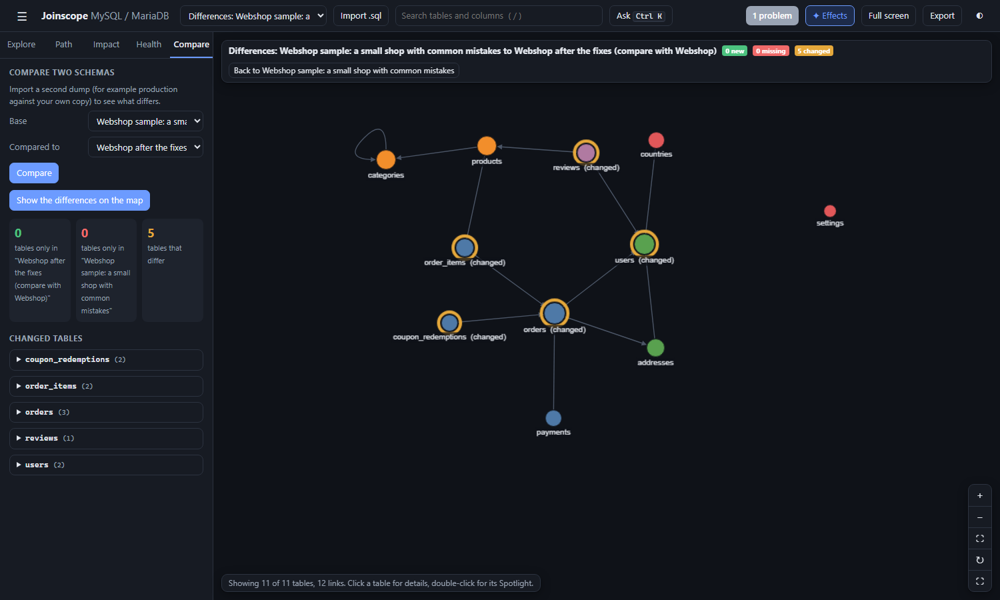

# Compare

Compare shows what differs between two exports of a database: tables, columns, types and foreign keys. Use it for production against staging, your copy against a colleague's, or before against after a migration.

## Comparing two schemas

1. Import both exports (see [Exporting your schema](exporting-your-schema.md)). Give each a clear **Name** in the import dialog, such as `production 2026-10-08` and `staging 2026-10-08`, so you can tell them apart.
2. Open the **Compare** tab.
3. Choose the **Base** (the reference, for example production) and **Compared to** (for example staging).
4. Press **Compare**.

Both lists offer every schema you have imported and the samples. **Compared to** starts on the most recently added one. To try Compare before you have two exports, choose **Webshop sample** as Base and **Webshop after the fixes** as Compared to (see the [example below](#example-webshop-before-and-after-the-fixes)).

If you pick the same schema twice, Joinscope asks you to choose two different ones.

## Reading the result

### The three numbers

| Number | Meaning |
|---|---|
| tables only in "Compared to" | Tables that exist only in the second schema (green, "new") |
| tables only in "Base" | Tables that exist only in the first schema (red, "missing") |
| tables that differ | Tables in both, with at least one difference |

If nothing differs, it says "The two structures are the same."

### The lists

- **Only in** *(compared-to name)*: the new tables, each tagged `new`.
- **Only in** *(base name)*: the missing tables, each tagged `missing`.
- **Changed tables**: one box per table, with the number of differences. Open it to see each one:

| Tag | Meaning | Example |
|---|---|---|
| `+ col` | Column only in the compared-to schema, with its type | `id bigint unsigned` |
| `- col` | Column only in the base schema | `legacy_code` |
| `type` | Column type or nullability changed, base first | `country_id: int null -> int unsigned null` |
| `+ fk` | Foreign key only in the compared-to schema | `country_id->countries(id) SET NULL` |
| `- fk` | Foreign key only in the base schema | `user_id->users(id) CASCADE` |

A foreign key is written as its columns, the table and columns it points to, and its delete rule. A foreign key whose delete rule changed therefore shows as one `- fk` and one `+ fk`.

Click a table name in the lists to go to it.

## Show the differences on the map

When there are differences, a **Show the differences on the map** button appears above the result. It draws one map with both schemas merged: every table of the compared-to schema, plus the tables only in the base.

| Look | Meaning |
|---|---|
| Green ring, label "(new)" | Only in the compared-to schema |
| Red dashed ring, faded, label "(missing)" | Only in the base schema |
| Amber ring, label "(changed)" | In both, with differences |
| No ring | The same in both |

The bar at the top left shows the merged map's name, the counts ("3 new", "1 missing", "5 changed"), and a **Back to** button that returns to the base schema. Tables with no links are shown on this map, so new or missing standalone tables are not hidden. This does not change your **Show tables with no links** setting: going back to a normal schema hides them again if it was off.

Click a table to see its differences at the top of the details panel: "Only in ...", or the list of changes for a changed table.

The merged map appears in the schema list as "Differences: *base* to *compared-to*". It is not remembered after you close the page.

## What is compared, and what is not

| Compared | Not compared |
|---|---|
| Which tables exist | Indexes and primary keys |
| Which columns exist, by name | Default values and comments |
| Column types, ignoring integer display widths | Column order |
| Whether a column allows `NULL` | Views and triggers |
| Foreign keys: columns, target, delete rule | `ON UPDATE` rules, engine, row counts |

Two differences that only come from MySQL and MariaDB writing things differently are ignored: integer display widths (MariaDB writes `bigint(20)`, MySQL 8 writes `bigint`), and `json`, which MariaDB stores as `longtext`.

A renamed column shows as one column removed and another added. A renamed table shows as one table missing and another new.

## Example: Webshop before and after the fixes

Joinscope includes a second Webshop sample, **Webshop after the fixes (compare with Webshop)**: the Webshop structure with the whole [fix script](health-checks.md#the-fix-script) applied. Choose **Webshop sample** as Base and **Webshop after the fixes** as Compared to, then press **Compare**.

The result: 0 new tables, 0 missing tables, 5 tables that differ.

| Table | Differences |
|---|---|
| `coupon_redemptions` | `+ col id bigint unsigned`, `+ fk order_id->orders(id) RESTRICT` |
| `order_items` | `type product_id: int not null -> bigint unsigned not null`, `+ fk product_id->products(id) RESTRICT` |
| `orders` | `+ fk user_id->users(id) RESTRICT`, `+ fk address_id->addresses(id) SET NULL`, `- fk user_id->users(id) CASCADE` |
| `reviews` | `+ fk product_id->products(id) RESTRICT` |
| `users` | `type country_id: int null -> int unsigned null`, `+ fk country_id->countries(id) SET NULL` |

Each line traces back to a finding: the new primary key, the five missing foreign keys (two with a type change first), and the cascade on `orders.user_id` replaced by `RESTRICT`. The redundant index on `order_items` is gone too, but Compare does not look at indexes, so it is not listed.

Press **Show the differences on the map** to see the five tables in amber. Then pick **Webshop after the fixes** in the schema list and open the Health tab: a single finding is left, `settings` with no links.

Do the same with your own database: export before a migration, run it on a copy, export again, import both and compare. It is a quick way to confirm that a migration did exactly what you meant, and nothing else.

Next: [Exports](exports.md)
