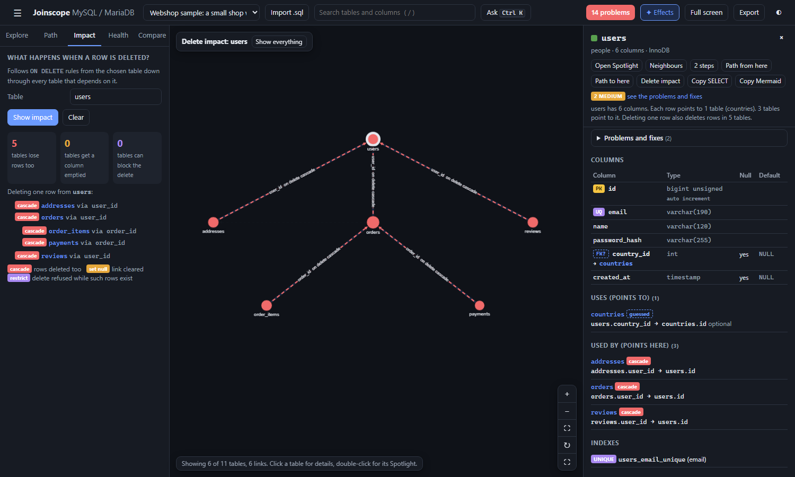

# Delete impact

Deleting one row can delete far more than you expect. The **Impact** tab shows what happens when one row of a table is deleted: which tables lose rows too, which get a column emptied, and which can stop the delete.



## The rules behind it

A **foreign key** is a rule in the database that a column must point to an existing row in another table, for example `orders.user_id` must hold the ID of a row in `users`. Each foreign key also says what happens to the linked rows when the row they point to is deleted. This is its `ON DELETE` rule:

| Rule | What the database does | Shown as |
|---|---|---|
| `CASCADE` | Deletes the linked rows too, and then whatever cascades from them | red, "lose rows" |
| `SET NULL` | Keeps the linked rows and empties their link column | amber, "get a column emptied" |
| `SET DEFAULT` | Keeps the linked rows and resets the link column to its default | amber, counted with set null |
| `RESTRICT` | Refuses the delete while linked rows exist | purple, "can block the delete" |
| `NO ACTION`, or no rule written | Behaves like `RESTRICT` in MySQL and MariaDB | purple |

Joinscope follows these rules from the table you choose, down through every table that depends on it, using the structure only. It does not look at your data, so it tells you what **can** happen, not how many rows a particular delete would touch.

## Running it

1. Open the **Impact** tab.
2. Type a table name in **Table** (suggestions appear as you type).
3. Press **Show impact**, or `Enter`.

Other ways:

- **Delete impact** in a table's details panel, or in its Spotlight.
- In the [command bar](command-bar-and-keys.md), type `delete users`, `impact users` or `what happens if I delete a user`.

Press **Clear** to empty the result and go back to the full map.

## Reading the result

### The three numbers

| Number | Meaning |
|---|---|
| Tables lose rows too | Tables reached by `CASCADE`, directly or through other cascades |
| Tables get a column emptied | Tables whose link is set to `NULL` (or to its default) |
| Tables can block the delete | Tables with a `RESTRICT` link: if they hold a matching row, the delete fails |

Each table is counted once, even if it is reached by more than one route.

### The tree

Below the numbers, "Deleting one row from users:" is followed by a tree. Each line shows:

- the rule as a coloured tag (`cascade`, `set null`, `restrict` and so on),
- the table (click to go to it),
- its row count, when the export had data,
- "via" and the link column, for example `via user_id`.

Under a cascade, the tree continues with whatever cascades from that table in turn. A table already shown elsewhere in the tree is marked "(already listed)" and not repeated. Set null and restrict lines do not continue, because nothing more is deleted through them.

If nothing depends on the table through foreign keys, the result says so.

### Guessed links are not covered

Guessed links (columns that look like links but have no foreign key) have no delete rule, so the database does nothing to them. When guessed links point to the chosen table, a note lists them: "Not covered: 1 guessed link (coupon_redemptions.order_id) has no foreign key, so the database will leave those rows pointing at nothing." Those rows become orphans: they point to an ID that no longer exists.

### On the map

The map shows only the tables involved, laid out from the chosen table, which gets a thick outline. Tables and links are coloured red (cascade), amber (set null) or purple (restrict). The bar at the top left reads "Delete impact: users", with **Show everything** to leave.

## One restrict blocks everything

A `RESTRICT` anywhere in the tree can stop the whole delete, even several steps down. Suppose deleting a user cascades to their orders, and some other table restricts deleting orders. If that table has a row for one of the user's orders, MySQL refuses to delete the user, and nothing is deleted at all, not even the cascades. The tree shows such tables in purple at whatever depth they sit.

## Examples from Webshop

### Deleting a user

Impact of `users`: **5** tables lose rows, 0 get a column emptied, 0 can block it.

```
cascade  addresses     via user_id
cascade  orders        via user_id
    cascade  order_items   via order_id
    cascade  payments      via order_id
cascade  reviews       via user_id
```

Deleting one customer silently deletes their addresses, their reviews, every order they placed, every line of those orders, and every payment record. In a real shop, the payment history is usually something you must keep. The [health checks](health-checks.md#financial-records-deleted-by-cascade) flag `orders.user_id` for exactly this reason and suggest `RESTRICT`.

### Deleting an order

Impact of `orders`: **2** tables lose rows (`order_items` and `payments`). The note adds that `coupon_redemptions.order_id` is a guessed link: redemption rows would be left pointing at an order that no longer exists.

### Deleting a category

Impact of `categories`: 0 tables lose rows, **1** gets a column emptied, **1** can block the delete.

- `set null categories via parent_id`: `categories` links to itself to make a tree. Child categories survive and become top-level categories.
- `restrict products via category_id`: while any product is in the category, the delete is refused. `products.category_id` has no `ON DELETE` clause, so it behaves as restrict.

## What it does not see

- **Triggers**. A trigger can delete or change other rows on delete. Joinscope lists triggers in the details panel but does not follow them.
- **Your application**. Many apps "soft delete" (set a `deleted_at` column) instead of deleting rows, or delete related rows in code. Delete impact only shows what the database itself does on a real `DELETE`.
- **Your data**. It shows which tables can be affected, not how many rows.

Next: [Health checks](health-checks.md)
