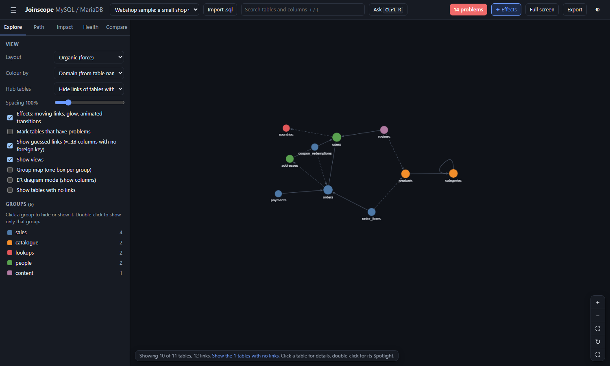

# Getting started

Joinscope is a single folder of web files. You open it in your browser, give it a database export, and it draws a map of your tables and the links between them. It also lists problems in the structure and gives the SQL to fix each one.

It runs entirely in your browser. There is no server, no account and nothing to install. Your file never leaves your computer (see [Privacy](privacy.md)).

## What you need

- A current version of Chrome, Edge, Firefox or Safari.
- A structure export of a MySQL or MariaDB database, or just the samples to begin with. PostgreSQL, SQLite and others are planned but not supported yet.

## Download and open

1. Download the latest release from the project's **Releases** page on GitHub, or use **Code > Download ZIP** on the project page.
2. Unzip it. Keep the folder together: `index.html` needs the `js`, `css`, `vendor` and `samples` folders next to it.
3. Double-click `index.html`. It opens in your default browser, straight from your disk.

That is all. You can switch your internet connection off and it still works.

## First look: the Webshop sample

Joinscope opens on a sample called **Webshop sample: a small shop with common mistakes**. It is a small online shop with 11 tables, written for Joinscope with the kind of mistakes real apps tend to have. This guide uses it for most examples.

Here is what you see.

**The top bar**, from left to right:

| Item | What it does |
|---|---|
| &#9776; | Hides or shows the side panel. On a narrow screen it slides the panel in and out. |
| Schema list | Switches between loaded schemas: the samples and anything you imported. The last entry, **Forget this imported schema**, removes the current imported schema from your browser. |
| **Import** | Opens the import dialog. You can also drop a file anywhere on the page. |
| Search box | Finds tables and columns by name. Press `/` to jump to it. |
| **Ask** `Ctrl K` | Opens the [command bar](command-bar-and-keys.md), where you type things like `payments to products` or `delete users`. |
| **14 problems** | Appears when the [health checks](health-checks.md) find something. Its colour is the worst severity found: red for high, amber for medium, grey for low. |
| **Effects** | Turns moving links, glow and animated transitions on or off. |
| **Full screen** | Hides the panels and gives the map the whole screen, for a projector. `P` does the same. |
| **Export** | Saves a picture, diagram, data dictionary, fix script or JSON (see [Exports](exports.md)). |
| &#9680; | Cycles the theme: light, dark, HUD. |

**The side panel** on the left has five tabs:

- **Explore**: how the map is drawn, and the list of groups. See [The map](the-map.md).
- **Path**: how two tables are connected. See [Path and joins](path-and-joins.md).
- **Impact**: what deleting a row does. See [Delete impact](delete-impact.md).
- **Health**: problems and fixes, then facts about the structure. See [Health checks](health-checks.md) and [Insights](insights.md).
- **Compare**: differences between two schemas. See [Compare](compare.md).

**The map** fills the middle. Each dot is a table. Arrows go from the table that holds a link to the table it points to. Dashed arrows are guessed links with no foreign key behind them (a foreign key is a rule in the database that a column must point to an existing row in another table).

**The status bar** at the bottom left says how many tables and links are shown. For Webshop it reads "Showing 10 of 11 tables, 12 links", because the `settings` table links to nothing and such tables are hidden at first. Click the link in the status bar to show it.

**The zoom buttons** at the bottom right: zoom in, zoom out, fit everything, lay out again, full screen.

**The details panel** opens on the right when you click a table.

Joinscope remembers which schema you looked at last and your view settings, and opens them again next time.

## A five-minute tour

### 1. Click a table

Click `orders`. Its direct neighbours stay bright and everything else fades. The details panel opens on the right with:

- a one-line summary: "orders has 6 columns. Each row points to 2 tables (users, addresses). 3 tables point to it. Deleting one row also deletes rows in 2 tables."
- its problems (1 high, 2 medium) with a link to the fixes,
- every column, with tags such as `PK` (primary key), `FK` (foreign key) and `FK?` (guessed link),
- the tables it uses and the tables that use it.

Hover over an arrow to see which column it uses. Click an empty part of the map, or press `Esc`, to clear the selection.

### 2. Double-click for the Spotlight

Double-click `orders`. The [Spotlight](spotlight.md) opens: `orders` in the middle with a plain-language description of every column, the tables it points to on the left (`users`, `addresses`) and the tables pointing to it on the right (`order_items`, `payments`, `coupon_redemptions`). Lines join the exact columns, coloured by what happens on delete.

Click a table name on either side to step into it. Press `Backspace` to go back and `Esc` to close.

### 3. See the problems

Click the red **14 problems** button. The Health tab opens and every table with a problem gets a coloured ring on the map. Open **Financial records deleted by cascade**: deleting a user deletes their orders, because `orders.user_id` has `ON DELETE CASCADE`. The fix, ready to copy, changes it to `RESTRICT`.

Open **Links without a foreign key** to see the five guessed links, each with a query to check your data and the SQL that adds the missing foreign key.

### 4. Check what a delete would do

Open the **Impact** tab, type `users` and press **Show impact**. It reports that 5 tables lose rows: `addresses`, `orders`, `reviews`, and through `orders` also `order_items` and `payments`. The map shows only those tables, coloured red.

Press **Clear** to go back to the full map.

### 5. Find how two tables connect

Open the **Path** tab. Type `payments` in **From** and `products` in **To**, then press **Find path**. The shortest chain is `payments` to `orders` to `order_items` to `products`, three steps, with the `JOIN` written out for you. The last step uses a guessed link, which is marked.

### 6. Ask in plain words

Press `Ctrl+K` and type `delete orders`, `payments to products`, `problems` or just a table name. Press `Enter` to run the first suggestion. See [Command bar and keys](command-bar-and-keys.md) for everything it understands.

### 7. Load your own database

Export the structure of your database (see [Exporting your schema](exporting-your-schema.md)), then drop the `.sql` or `.sql.gz` file (or a SQLite `.db` file) on the page, or press **Import**. The import dialog also has **From a query**, a read-only query to run in your own SQL console; a box where you can paste `CREATE TABLE` statements or that query's result; and a **Name** field so you can tell imports apart later.

Your schema is then remembered in your browser for next time. Use **Forget this imported schema** in the schema list to remove it.

## The other samples

Three more samples are in the schema list:

- **Webshop after the fixes (compare with Webshop)**: the same shop with Joinscope's fix script applied. Compare it with the Webshop sample to see what the fixes change (see [Compare](compare.md#example-webshop-before-and-after-the-fixes)).
- **Chinook sample: a digital music store**, a public example database.
- **Sakila sample: a DVD rental shop**, a public example database. It has views, so you can try **Show views**.

Next: [Exporting your schema](exporting-your-schema.md)
