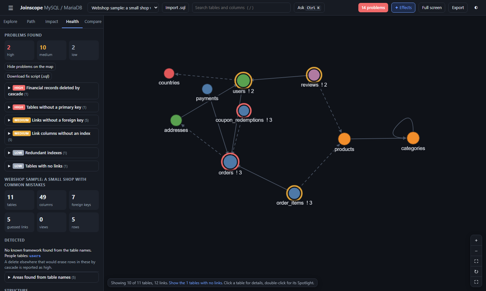

# Health checks

Joinscope reads the structure of your database and lists the problems it finds. Each problem comes with a plain explanation, often a query to check your data first, and the SQL to fix it. **Download fix script** collects every fix in one file for you to review.

The checks are fixed rules applied to the structure. They are not an AI, and they never look at your data, your code or your queries. They point at things worth a look; you decide what to change.



## Before you run any fix

> **Read every statement before you run it, and take a backup first.** Joinscope writes fixes from the structure alone. It cannot know your data, your application or your intentions. A fix that is right for one app can break another.

- Make a full backup, for example `mysqldump -u USER -p --single-transaction --routines --triggers DATABASE > backup.sql`, and check that the file is complete.
- Try the fixes on a copy of the database first, never straight on production.
- When a finding has a check query, run it first. It must return 0.
- `ALTER TABLE` on a large table can take a long time and may lock the table. Plan it for a quiet moment.
- Changing a delete rule changes how your application behaves. For example, after switching to `RESTRICT`, a delete that used to work will fail with an error until the app handles it.

## Where problems appear

- The **problems** button in the top bar, for example "14 problems" for Webshop. Its colour is the worst severity: red, amber or grey. Click it to open the Health tab and mark the problems on the map.
- The **Health** tab: the full list, grouped by kind, followed by the [insights](insights.md).
- The **details panel** of a table: the chips and the **Problems and fixes** box list that table's findings.
- The **Spotlight**: the same box under the table's columns, and a red, amber or grey **!** on neighbour cards.
- The **map**, when **Mark tables that have problems** is on: a ring around each table with findings, in the colour of its worst one, and the number of findings in its label.
- The [command bar](command-bar-and-keys.md): type `problems`, `issues`, `health` or `check`.

## Severity levels

| Severity | Colour | Meaning |
|---|---|---|
| High | Red | Data can be lost or corrupted, or basic tools break: cascades that wipe people or money records, missing primary keys, links of different types, links to missing tables. |
| Medium | Amber | The database is not protecting something it should, or is slow: links without a foreign key, link columns without an index, history wiped by cascade. |
| Low | Grey | Worth knowing, often fine: redundant indexes, very wide tables, unmatched `*_id` columns, tables with no links. |

The list is sorted from high to low.

## Reading a finding

The Health tab groups findings by kind. Each group shows its severity, its name and how many findings it holds; click to open it. Each finding has:

1. **Severity and title**, then the table and column it concerns (click to go there).
2. **Explanation** of what is wrong and why it matters.
3. **1. Check for broken rows first (must return 0)**: present for links without a foreign key. A query to run on your database before the fix.
4. **Fix (SQL)** (numbered **2.** when there is a check): the statements that fix it, for MySQL and MariaDB.
5. **Same fix in a Laravel migration**: shown only when the schema looks like a Laravel app (it has a `migrations` table with a `batch` column) or a [profile](profiles.md) says `framework: 'laravel'`. These lines go inside a migration's `Schema::table(...)` callback.
6. **Copy fix**: copies the fix. When there is a check query, it is copied too, above the fix, as a comment.

Some findings have no fix, because the right change depends on your design. They explain what to look at instead.

## The fix script

**Download fix script (.sql)** in the Health tab, or **Export > Suggested fixes (SQL script)**, saves every available fix in one file named after the schema, for example `Webshop_sample_a_small_shop_with_common_mistakes-suggested-fixes.sql`. The command bar's `fix` does the same.

- It starts with a header reminding you to review every statement and back up first.
- Each fix has a comment line with its severity, title, table and column.
- When a finding has a check query, it is included as a comment with "Run this first; it must return 0".
- Findings without a fix, and findings accepted in a profile, are left out.
- An index fix is left out when the script also adds a foreign key on the same column, because the foreign key creates the index itself.
- Fixes are in severity order, high first.

Joinscope never runs anything. The script is a starting point to edit, not something to run blindly. Read the notes under each check below. `MODIFY` lines restate the whole column; Joinscope carries over its type, `NULL` rule, default and comment, but not other attributes such as a character set or `ON UPDATE`.

To see what the whole Webshop script changes, compare the **Webshop** sample with the **Webshop after the fixes** sample (see [Compare](compare.md#example-webshop-before-and-after-the-fixes)). After the fixes, only one finding is left: `settings` has no links, which is fine.

Webshop's script begins like this:

```sql
-- Suggested fixes for Webshop sample: a small shop with common mistakes
-- Generated by Joinscope. Review every statement before running it, and take a backup first.

-- [high] Financial records are deleted with their users row: orders.user_id
ALTER TABLE `orders` DROP FOREIGN KEY `orders_user_id_foreign`;
ALTER TABLE `orders` ADD CONSTRAINT `orders_user_id_foreign` FOREIGN KEY (`user_id`) REFERENCES `users` (`id`) ON DELETE RESTRICT;

-- [high] Table without a primary key: coupon_redemptions
ALTER TABLE `coupon_redemptions` ADD COLUMN `id` BIGINT UNSIGNED NOT NULL AUTO_INCREMENT PRIMARY KEY FIRST;

-- [medium] Link without a foreign key: coupon_redemptions.order_id
-- Run this first; it must return 0:
--   SELECT COUNT(*) AS broken_rows FROM `coupon_redemptions` c LEFT JOIN `orders` p ON p.`id` = c.`order_id`
--   WHERE c.`order_id` IS NOT NULL AND p.`id` IS NULL;
ALTER TABLE `coupon_redemptions` ADD CONSTRAINT `coupon_redemptions_order_id_foreign` FOREIGN KEY (`order_id`) REFERENCES `orders` (`id`) ON DELETE RESTRICT;
```

## What Webshop finds

The Webshop sample has 14 findings:

| Severity | Finding | Where |
|---|---|---|
| High | Financial records deleted by cascade | `orders.user_id` |
| High | Table without a primary key | `coupon_redemptions` |
| Medium | Link without a foreign key (5) | `coupon_redemptions.order_id`, `order_items.product_id`, `orders.address_id`, `reviews.product_id`, `users.country_id` |
| Medium | Link column without an index (5) | the same five columns |
| Low | Redundant index | `order_items.order_id` |
| Low | Tables with no links | `settings` |

## Every check

Each check below is named as it appears in the Health tab, with its severity.

### People records erased when a lookup entry is deleted

**Severity:** high.

**When it fires:** a foreign key with `ON DELETE CASCADE` where the table holding the key is a **people table** and the table it points to is not. The title reads, for example, "Deleting a row in countries deletes rows in users".

**People tables** are tables holding people, such as `users`, `customers` or `employees`. Joinscope finds them from table names (see [automatic detection](detection.md)), and a [profile](profiles.md) can name them instead with `peopleTables`.

**Why it matters:** a cascade means that deleting a row in a small lookup table (a country, a category, a type) deletes every person linked to it, and then everything that cascades from those people. One click in an admin screen can erase thousands of accounts. If your application archives or soft-deletes people, the database cascade ignores that completely.

**Example:** Webshop does not have this problem, but it would if `users.country_id` had a foreign key to `countries` with `ON DELETE CASCADE`. Deleting "France" from `countries` would then delete every French user, and through `users` also their addresses, orders, order lines, payments and reviews.

**The fix:** keep the person and clear the link instead (`SET NULL`). Joinscope drops the foreign key, makes the column nullable if it is not already, and adds the foreign key back with `ON DELETE SET NULL`:

```sql
ALTER TABLE `users` DROP FOREIGN KEY `users_country_id_foreign`;
ALTER TABLE `users` ADD CONSTRAINT `users_country_id_foreign` FOREIGN KEY (`country_id`) REFERENCES `countries` (`id`) ON DELETE SET NULL;
```

When the column is `NOT NULL`, a `MODIFY ... NULL` line comes between the two. That line keeps the column's default and comment.

Only the table directly holding the foreign key is checked. A people table reached through several cascades shows up in [Delete impact](delete-impact.md) instead.

### Foreign keys to missing tables

**Severity:** high.

**When it fires:** a foreign key refers to a table that is not in the export. The title is "Foreign key points to a table that is not here".

**Why it matters:** either the export is partial (you exported some tables, not all), or the target table was dropped and the database now holds a foreign key to nothing. The link is not drawn on the map; the details panel tags it "table missing".

**The fix:** none is generated. Export the whole database again. If the table really is gone, decide whether to recreate it or drop the foreign key.

### Linked columns with different types

**Severity:** high.

**When it fires:** a foreign key's column and the column it points to have different types, for example `int` and `int unsigned`, or `int` and `bigint`. Display widths are ignored (`int(11)` and `int` count as the same), but signed and unsigned are different.

**Why it matters:** joins on columns of different types are slower, because the database may have to convert values, and values that fit in one column may not fit in the other.

**The fix:** change the linking column to the parent's type, keeping whether it allows `NULL`:

```sql
ALTER TABLE `users` MODIFY `country_id` INT UNSIGNED NULL;
```

Two cautions. First, `MODIFY` restates the whole column: the default and comment are carried over, but check for other attributes such as a character set. Second, MySQL may refuse to change a column that a foreign key uses; if it does, drop the foreign key, change the column, and add the foreign key back.

**Only declared foreign keys are checked here.** Webshop has two links whose types differ, `order_items.product_id` (`int`) to `products.id` (`bigint unsigned`), and `users.country_id` (`int`) to `countries.id` (`int unsigned`). Both are guessed links, so this check does not report them. Instead, their [Links without a foreign key](#links-without-a-foreign-key) findings mention the difference and change the column type as part of the fix.

### Financial records deleted by cascade

**Severity:** high.

**When it fires:** a foreign key with `ON DELETE CASCADE` where the table holding the key has a money-related name and the table it points to does not. The title reads "Financial records are deleted with their users row" (with the parent table's name).

Money-related names contain one of: `collect`, `payment`, `receipt`, `transaction`, `income`, `expense`, `invoice`, `refund`, `ledger`, `payroll`, `salar`, `order`, `charge`, `billing`. Tables whose names end in a setup word (`type`, `category`, `group`, `setting`, `template`, `master`, `translate`, `gender`, `religion`, `blood`, `upload`, singular or plural) are skipped, since they are lists of options rather than records.

**Why it matters:** payment history is usually kept for accounting and audit. A cascade deletes it silently when someone deletes the customer, product or account it belongs to.

**Example:** in Webshop, `orders.user_id` points to `users` with `ON DELETE CASCADE`. Deleting a user deletes all their orders, and from there their order lines and payments (see [Delete impact](delete-impact.md#deleting-a-user)). `payments.order_id` also cascades, but it is not reported on its own because both `payments` and `orders` have money-related names.

**The fix:** switch the rule to `RESTRICT`, so the database refuses to delete a user who still has orders:

```sql
ALTER TABLE `orders` DROP FOREIGN KEY `orders_user_id_foreign`;
ALTER TABLE `orders` ADD CONSTRAINT `orders_user_id_foreign` FOREIGN KEY (`user_id`) REFERENCES `users` (`id`) ON DELETE RESTRICT;
```

The Laravel version is `$table->dropForeign(['user_id']);` then `$table->foreign('user_id')->references('id')->on('users')->restrictOnDelete();`.

After this change, your application must handle the refused delete: for example by soft-deleting the user (a `deleted_at` column), or by anonymising their personal details while keeping the orders.

### History records deleted by cascade

**Severity:** medium.

**When it fires:** like the previous check, but for history-like tables. The table holding the key has a name containing `mark`, `result`, `grade`, `assessment`, `attendance`, `report_card`, `transcript`, `summary_report`, `history` or `audit`, the table it points to does not, and the table is not already reported as financial. Setup tables are skipped in the same way. The title reads "History records are deleted with their ... row".

**Why it matters:** history, results and audit trails are usually kept, even when the thing they describe is removed. An audit log that disappears with the user it records is not much of an audit log.

**Example:** Webshop has none. An `audit_logs` table with `user_id` pointing to `users` and `ON DELETE CASCADE` would be reported.

**The fix:** the same as for financial records: drop the foreign key and add it back with `ON DELETE RESTRICT`, or use soft deletes.

### Links without a foreign key

**Severity:** medium.

**When it fires:** for every guessed link: a column that looks like a link but has no foreign key. The title is "Link without a foreign key". How links are guessed is explained in [The map](the-map.md#show-guessed-links).

**Why it matters:** without a foreign key, the database accepts any value, including IDs that do not exist, and deleting the parent row leaves child rows pointing at nothing (orphans). Joins on such columns quietly return fewer rows than expected.

**Example:** Webshop has five: `coupon_redemptions.order_id`, `order_items.product_id`, `orders.address_id`, `reviews.product_id` and `users.country_id`. For `orders.address_id`:

**1. Check for broken rows first (must return 0):**

```sql
SELECT COUNT(*) AS broken_rows FROM `orders` c LEFT JOIN `addresses` p ON p.`id` = c.`address_id`
WHERE c.`address_id` IS NOT NULL AND p.`id` IS NULL;
```

This counts the orders (`c`, the child) whose `address_id` is filled in but matches no address (`p`, the parent). If it returns more than 0, the foreign key cannot be added until those rows are fixed: set their `address_id` to `NULL`, point them at a real row, or delete them.

**2. Fix (SQL):**

```sql
ALTER TABLE `orders` ADD CONSTRAINT `orders_address_id_foreign` FOREIGN KEY (`address_id`) REFERENCES `addresses` (`id`) ON DELETE SET NULL;
```

The delete rule depends on the column: `SET NULL` when it can be empty (as here), `RESTRICT` when it is `NOT NULL`. The constraint is named `<table>_<column>_foreign`.

Notes before running these fixes:

- **The types must match.** MySQL refuses a foreign key between columns of different types. When the types differ, the explanation says so and the fix changes the column to the parent's type first. In Webshop, `order_items.product_id` is `int` while `products.id` is `bigint unsigned`, so its fix is:

  ```sql
  ALTER TABLE `order_items` MODIFY `product_id` BIGINT UNSIGNED NOT NULL;
  ALTER TABLE `order_items` ADD CONSTRAINT `order_items_product_id_foreign` FOREIGN KEY (`product_id`) REFERENCES `products` (`id`) ON DELETE RESTRICT;
  ```

  The same happens for `users.country_id` (`int`, changed to `INT UNSIGNED`). The `MODIFY` line keeps the column's default and comment.
- **The foreign key brings its own index.** If the column has no index, MySQL creates one when the foreign key is added. The fix script therefore leaves out the matching [Link columns without an index](#link-columns-without-an-index) fix whenever it includes the foreign key. If you copy fixes one by one from the panel, copy only the foreign key, or two identical indexes will result.
- **The guess may be wrong.** If the column is not really a link, do not add the foreign key. Accept the finding in a [profile](profiles.md) instead.

### Link columns without an index

**Severity:** medium.

**When it fires:** a guessed link column that is not the first column of any index or of the primary key. The title is "Link column without an index". Declared foreign keys are not checked, because MySQL always gives them an index.

**Why it matters:** an **index** lets the database find rows by a column without reading the whole table. Without one, every lookup or join on the column reads every row, which gets slow as the table grows.

**Example:** in Webshop, the same five guessed links have no index.

**The fix:**

```sql
ALTER TABLE `orders` ADD INDEX `orders_address_id_index` (`address_id`);
```

As the explanation says, adding the foreign key from the previous check also creates the index, so the fix script leaves this fix out when it includes that foreign key. Use it on its own only if you decide not to add the foreign key (for example after accepting the missing foreign key in a [profile](profiles.md)).

### Tables without a primary key

**Severity:** high, or low for a framework's own bookkeeping table.

**When it fires:** a table has no primary key. The title is "Table without a primary key".

**Why it matters:** a **primary key** identifies each row uniquely. Without one, rows cannot be told apart reliably: updating or deleting "this row" may hit several, replication can break, and most admin tools refuse to edit the table.

Some frameworks ship tables without a primary key on purpose (Laravel's `password_reset_tokens` and `cache` tables, for example). When Joinscope recognises the framework, these are reported as low, "Usually safe to leave", with no fix. See [automatic detection](detection.md).

**Example:** Webshop's `coupon_redemptions` has `coupon_code`, `order_id` and `redeemed_at`, and no primary key.

**The fix:** add an `id` column as the first column:

```sql
ALTER TABLE `coupon_redemptions` ADD COLUMN `id` BIGINT UNSIGNED NOT NULL AUTO_INCREMENT PRIMARY KEY FIRST;
```

This fails if the table already has a column named `id`. Consider also whether a natural key fits better. If a coupon can be redeemed only once per order, `(coupon_code, order_id)` could be the primary key. Check for duplicates first:

```sql
SELECT coupon_code, order_id, COUNT(*) FROM coupon_redemptions
GROUP BY coupon_code, order_id HAVING COUNT(*) > 1;
```

### Redundant indexes

**Severity:** low.

**When it fires:** a plain index whose columns are the leading columns of another index, unique index or the primary key. For example, an index on `(a)` is covered by an index on `(a, b)`. When two indexes are identical, the one whose name sorts later is reported. The title is "Index already covered by another".

**Why it matters:** every index takes disk space and slows down every insert and update. A covered index adds that cost for nothing, because the database can use the wider one instead.

**Example:** Webshop's `order_items` has two indexes on `order_id` alone: `order_items_order_id_foreign` and `order_items_order_id_index`. The second is reported.

**The fix:**

```sql
ALTER TABLE `order_items` DROP INDEX `order_items_order_id_index`;
```

If a foreign key relies on the dropped index, MySQL uses the remaining one. Unique and fulltext indexes are never reported as redundant.

### Very wide tables

**Severity:** low.

**When it fires:** a table has more than 45 columns. The title is "Very wide table".

**Why it matters:** wide tables are slower to read and harder to understand. They often mix several things in one place.

**The fix:** none is generated. Consider moving groups of rarely used columns into their own table, linked one-to-one.

### `*_id` columns with no matching table

**Severity:** low.

**When it fires:** a column ends in `_id`, is not a key, and no table matches its name. One finding is made per column name, listing every table that has it. The title reads, for example, "tenant_id has no matching table".

**Why it matters:** the column may be a link to a table that is missing from the export, a link to another system (an external ID), a marker such as a tenant ID, or a leftover from removed code. Joinscope cannot tell which.

**The fix:** none is generated. If the target table exists under a name Joinscope did not guess, add a real foreign key. If the column is not a link, it is fine; you can accept the finding in a [profile](profiles.md). Webshop has none.

### Deletes that reach many tables

**Severity:** low.

**When it fires:** deleting one row of a table cascades through 10 or more foreign keys (counted as in [Delete impact](delete-impact.md)). The title reads "One delete reaches 12 tables" (with the count).

**Why it matters:** a single delete with such a wide reach is easy to trigger by accident and hard to undo.

**The fix:** none is generated. Review the cascades in Delete impact, and consider soft deletes (a `deleted_at` column) for this table. In Webshop, deleting a user reaches 5, below the threshold.

### Tables with no links

**Severity:** low.

**When it fires:** one finding lists every table that has no foreign key and no guessed link, in either direction. A framework's own bookkeeping tables are left out. Tables in the profile's `keep` list, and tables accepted one by one with `{ kind: 'isolated', table: ... }`, are left out too. The title reads, for example, "1 table has no links at all".

**Why it matters:** settings and log tables are normally like this. Other tables with no links may be missing their foreign keys, or be left over from an old feature.

**Example:** Webshop's `settings`, a key and value table, which is fine.

**The fix:** none is generated. These tables are hidden on the map until you tick **Show tables with no links**.

### Empty tables the code no longer uses

**Severity:** medium. Appears only with code usage data (see below).

**When it fires:** a table has no rows, the attached usage data shows no working code using it, and it is not listed in the profile's `keep` (framework tables count as kept). The title is "Empty, and no code uses it".

**The fix:** `DROP TABLE IF EXISTS`, but only when no other table points to it; otherwise the explanation names the tables to deal with first.

### Tables the app reads but never fills

**Severity:** low. Appears only when a profile sets `dormant`.

**When it fires:** for each entry in the profile's `dormant` list whose table exists. The title is "Read by the app, but nothing writes to it", with the note from the profile.

### Outside what this project does

**Severity:** medium for the summary, low for each table. Appears only when a profile sets `outOfScope`.

**When it fires:** for each rule in the profile's `outOfScope` list whose pattern matches table names. One summary names the tables and says which still hold rows.

**About code usage data.** "Empty tables the code no longer uses" needs to know which tables the application's code uses. Joinscope never reads code itself; that data can only come from a project add-on that attaches it to a preloaded schema. Files you import never carry it, so for an imported schema that one check does not appear. The two profile checks above work on any schema.

### Reviewed and kept on purpose

**Severity:** low.

**When it fires:** when a [profile](profiles.md) lists findings under `accepted` and some of them match. The matching findings leave the list, the map rings and the fix script, and this one summary names each of them with the reason given: "N findings reviewed and kept on purpose". An accepted finding is never silently lost.

## What the checks cannot know

- **Your data.** A link "without a foreign key" may be perfectly clean, or full of orphans. The check query tells you.
- **Your intent.** A cascade may be exactly what you want, for example deleting a cart's lines with the cart. Accept such findings in a profile.
- **Names that do not follow the usual patterns.** A link column called `owner` instead of `owner_id` is not guessed, and a money table called `ledger_lines` is caught but one called `entries` is not.

Next: [Insights](insights.md)
