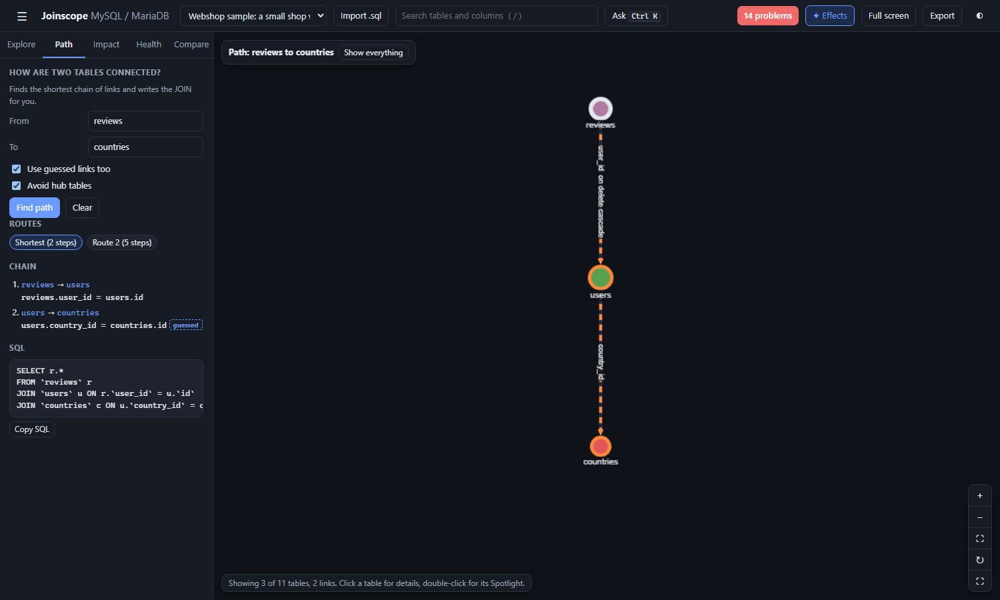

# Path and joins

"How do I get from payments to products?" is a question every developer asks of an unfamiliar database. The **Path** tab answers it: it finds the shortest chain of links between two tables and writes the SQL `JOIN` for you.

A **join** combines rows from two tables in one query by matching a link column, for example `orders.user_id = users.id`. A **foreign key** is the database rule behind such a link. A **guessed link** is a column that looks like a link but has no foreign key (see [The map](the-map.md#show-guessed-links)).



## Finding a path

1. Open the **Path** tab.
2. Type a table in **From** and another in **To**. The boxes suggest table names as you type. Capitals do not matter.
3. Press **Find path**, or `Enter` in either box.

Other ways to start:

- In the details panel of a table, press **Path from here** or **Path to here**. When both boxes are filled, the path appears at once.
- In the [command bar](command-bar-and-keys.md), type `payments to products`, `path from payments to products`, `how are payments and products connected` or `payments -> products`.

### Options

| Option | Effect |
|---|---|
| Use guessed links too | Lets the chain use guessed links. On by default. Untick it to use only real foreign keys. |
| Avoid hub tables | Does not pass through hub tables (tables with very many links pointing to them, see [The map](the-map.md#hub-tables)), unless the hub is the start or the end. On by default, because a route through `users` is short but rarely the one you mean. It uses the threshold chosen under **Hub tables** in the Explore tab, or 20 when that is set to "Show every link". |

### How the search works

Links are followed in both directions: from a table to the table it points to, and back. The shortest chain is the one with the fewest steps. Links from views and links from a table to itself are not used.

Joinscope then looks for alternatives by leaving out one link of the shortest chain at a time. Up to four routes are kept, shortest first.

## The result

**Routes**: when there is more than one route, chips such as "Shortest (3 steps)" and "Route 2 (4 steps)" let you switch between them.

**Chain**: each step, for example `payments` &rarr; `orders`, with the matching columns underneath (`payments.order_id = orders.id`). A step that uses a guessed link is tagged `guessed`.

**SQL**: the query, with a **Copy SQL** button.

**On the map**: only the tables of the route are shown, laid out from the start table, with the route drawn in orange and the start table outlined. A guessed link on the route is drawn even if guessed links are switched off in the Explore tab. The bar at the top left reads "Path: payments to products"; press **Show everything** there, or **Clear** in the Path tab, to go back.

## Example: Webshop, payments to products

From `payments` to `products`, the shortest route has 3 steps: `payments` &rarr; `orders` &rarr; `order_items` &rarr; `products`.

```sql
SELECT p.*
FROM `payments` p
JOIN `orders` o ON p.`order_id` = o.`id`
JOIN `order_items` oi ON oi.`order_id` = o.`id`
JOIN `products` p2 ON oi.`product_id` = p2.`id`;
```

The last step, `order_items.product_id`, is a guessed link: Webshop has no foreign key on it. Route 2 has 4 steps, through `users` and `reviews`, and also ends on a guessed link (`reviews.product_id`).

Untick **Use guessed links too** and search again: "No chain of links connects these tables." This shows that, as far as the database itself is concerned, payments and products are not connected at all. The [health checks](health-checks.md#links-without-a-foreign-key) suggest adding those foreign keys.

If **Avoid hub tables** is on and the only route goes through a hub, the message says so and suggests unticking it.

## Reading the generated SQL

- Each table gets a short alias made of the first letters of its name: `orders` becomes `o`, `order_items` becomes `oi`. When two tables would get the same alias, a number is added (`p`, then `p2`).
- The query selects only the start table's columns (`SELECT p.*`). Change it to the columns you need.
- It uses plain `JOIN` (an inner join), which keeps only rows that have a match at every step. If a link column can be empty, such as `orders.address_id`, rows with an empty link are dropped. Use `LEFT JOIN` for those steps if you want to keep them.
- Joining from a parent to many children (here `orders` to `order_items`) repeats the parent row once per child. Add `DISTINCT` or `GROUP BY` if you need one row per start row.

## Copy SELECT

**Copy SELECT** (in the details panel and in the Spotlight) is a different tool. It copies a query of one table with a `LEFT JOIN` to **every table it points to**, so you can see each row with its parents' details. A guessed link gets a `-- guessed link, no foreign key:` comment on the line above its join.

For Webshop's `orders`:

```sql
SELECT o.*
FROM `orders` o
LEFT JOIN `users` u ON u.`id` = o.`user_id`
-- guessed link, no foreign key:
LEFT JOIN `addresses` a ON a.`id` = o.`address_id`;
```

Links to tables missing from the export, and links from a table to itself, are left out.

Next: [Delete impact](delete-impact.md)
