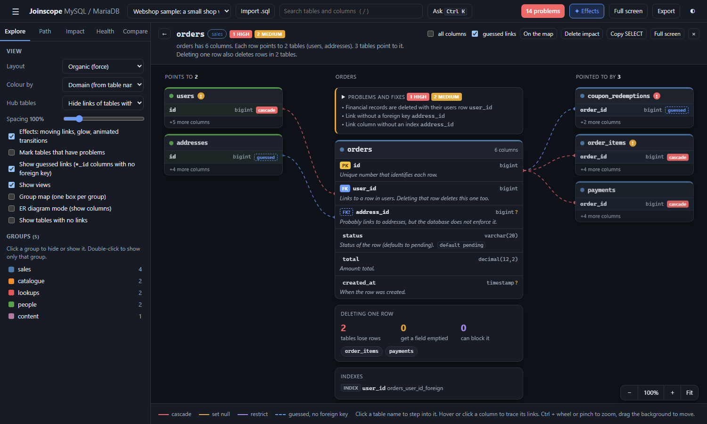

# Spotlight

The Spotlight shows one table up close. The table sits in the middle with every column explained in plain words. The tables it points to are on the left, the tables pointing to it are on the right, and lines join the exact columns. It is the best way to understand a table you did not design.

## Opening it

- Double-click a table on the map.
- Press **Open Spotlight** in the details panel.
- In the [command bar](command-bar-and-keys.md) (`Ctrl+K`), type a table name and choose "Spotlight ...".

The address bar then ends in `#spot=orders` (or whichever table). Opening `index.html` with that ending opens the Spotlight on that table directly.

## What you see

### The top bar

- **&larr;** goes back to the previous table (also `Backspace`, or `Alt+Left`). From the first table, it closes the Spotlight.
- A trail of the last tables you visited, then the current table name, its group, and chips counting its problems by severity. Click the chips to open the problems panel.
- A one-line summary, for example "orders has 6 columns. Each row points to 2 tables (users, addresses). 3 tables point to it. Deleting one row also deletes rows in 2 tables."

On the right of the top bar:

| Control | What it does |
|---|---|
| all columns | Shows every column of the side tables, not just the linked ones. |
| guessed links | Includes guessed links (dashed on the map). On by default. Untick to see only real foreign keys. |
| On the map | Closes the Spotlight and shows this table with its neighbours on the map. |
| Delete impact | Closes the Spotlight and runs [Delete impact](delete-impact.md) for this table. |
| Copy SELECT | Copies a `SELECT` with a `LEFT JOIN` to every table this one points to. See [Path and joins](path-and-joins.md#copy-select). |
| Full screen | Full-screen presentation (also `P`). |
| &times; | Closes the Spotlight (also `Esc`). |

### The middle: the table itself

One row per column, with:

- tags: `PK` (primary key), `FK` (foreign key), `FK?` (guessed link), `UQ` (unique),
- the column name and a short type, with `?` when the column can be empty (allows `NULL`),
- a description,
- the default value, when there is one.

**Where descriptions come from.** If the column has a `COMMENT` in the database, that comment is shown as written. Otherwise Joinscope writes one from the column's name, type and links. These written descriptions are shown in grey italics; hover over one to see "Written from the column name. Add a COMMENT to the column to replace it."

Some of the descriptions Joinscope writes:

| Column | Description |
|---|---|
| The single primary key column | "Unique number that identifies each row." |
| A foreign key | "Links to a row in users. Deleting that row deletes this one too." The last sentence follows the delete rule: for set null "Deleting that row empties this field.", for restrict "That row cannot be deleted while this one points to it." "(optional)" is added when the column can be empty. |
| A guessed link | "Probably links to addresses, but the database does not enforce it." |
| `*_id` with no matching table | "ID of a ... (no matching table in this schema)." |
| `created_at`, `updated_at`, `deleted_at` | When the row was created, last changed, or soft-deleted ("Empty means it is active.") |
| Names containing `password` | "Password, stored hashed." |
| `ENUM` columns | "One of: ..." with the allowed values. |
| `is_`, `has_`, `can_` names, or `tinyint(1)` | "Yes or no: ..." |
| `status` | "Status of the row", with its default. |
| Dates and times | The name and the type, for example "Paid (timestamp)." |
| Amounts, prices, totals in a number type | "Amount: ..." |
| `email`, `phone`, codes and references, files and images, JSON, long text | A matching short phrase. |

In Webshop's `orders`, for example: `status` reads "Status of the row (defaults to pending).", `total` reads "Amount: total.", and `address_id` reads "Probably links to addresses, but the database does not enforce it."

These are guesses from names, so read them as hints. Adding `COMMENT` to your columns gives everyone better descriptions, here and in the [data dictionary](exports.md).

### Under the table

Depending on the table, panels and notes appear below the column list:

- **Problems and fixes**: present when the table has findings. Its heading lists every finding's title; open it to see each one with its check query, fix and copy button, as in the [Health tab](health-checks.md).
- **Points to itself**: for a self-link such as `categories.parent_id`, which makes a tree of parent and child rows.
- **Polymorphic links**: pairs such as `commentable_type + commentable_id`, where each row can point to a different table.
- **Used by views**: links to each view that reads this table.
- **Deleting one row**: how many tables lose rows, get a field emptied, or can block the delete, with a chip for each table that loses rows. See [Delete impact](delete-impact.md).
- **Indexes**: each index with its type, columns and name.

For a view, the middle shows the view's SQL instead of columns, and the summary names the tables it is built from.

### Left and right: the neighbours

The left column, **Points to**, has a card for each table this one links to. The right column, **Pointed to by**, has a card for each table that links to this one. The count is in each column's title.

Each card shows the table name, its row count when known, a red, amber or grey **!** if it has problems, and the columns used by the links. Each linked column carries its delete rule: `cascade`, `set null`, `restrict` or `guessed`. "+N more columns" says how many are not shown; tick **all columns** to see them.

### The lines

Lines join a column in the middle card to the matching column in a side card, coloured by delete rule:

| Colour | Rule |
|---|---|
| Red | cascade: deleting the parent row deletes this row |
| Amber | set null: deleting the parent row empties the link |
| Purple | restrict: the parent row cannot be deleted while this row points to it |
| Dashed | guessed, no foreign key |

A legend at the bottom repeats this.

## Working in the Spotlight

- **Trace a column**: hover over a column in the middle card. Its lines and the linked columns light up and the rest fades. Click to keep it lit; click again to release.
- **Trace a table**: hover over a side card to light up all its lines. Click the card to keep it lit.
- **Step into a neighbour**: click the name of a side card. The Spotlight moves to that table and adds it to the trail. `Backspace` goes back.
- **Links elsewhere**: while the Spotlight is open, clicking a table name in the side panel or picking a search result also steps the Spotlight to that table.

### Zoom and move

Large tables with many neighbours may not fit. The zoom box at the bottom right has **&minus;**, the current zoom (click it for 100%), **+** and **Fit**. You can also:

- hold `Ctrl` (or `Cmd` on a Mac) and use the mouse wheel, or pinch on a touchpad,
- drag the background to move,
- use the keys `+` or `=` (zoom in), `-` (zoom out), `0` (fit everything) and `1` (actual size).

Zoom goes from 25% to 250%.

## Example: Webshop's orders

Double-click `orders` in the Webshop sample.

- **Points to 2**: `users` (via `user_id`, red, cascade) and `addresses` (via `address_id`, dashed, guessed).
- **Pointed to by 3**: `order_items` and `payments` (red, cascade) and `coupon_redemptions` (dashed, guessed).
- **Problems and fixes**: 1 high (financial records deleted with their user) and 2 medium (the guessed `address_id` link has no foreign key and no index).
- **Deleting one row**: 2 tables lose rows (`order_items`, `payments`).

Untick **guessed links**: `addresses` and `coupon_redemptions` disappear, which is exactly what the database itself knows about.

Next: [Path and joins](path-and-joins.md)
